<p align="center">
  
</p>

<h1 align="center">Feuillet</h1>

<p align="center"><b>Gestionnaire de stock d'une librairie en ligne</b><br>
Catalogue, ventes, retours et réapprovisionnement. Projet de Génie Logiciel, L3.</p>

<p align="center">
  <a href="https://github.com/hunixcode/feuillet/actions/workflows/backend.yml"></a>
  <a href="https://github.com/hunixcode/feuillet/actions/workflows/frontend.yml"></a>
  <a href="https://github.com/hunixcode/feuillet/actions/workflows/e2e.yml"></a>
  <a href="LICENSE"></a>
  <br>
  
  
  
  
  
  
  
  
  
</p>

Deux espaces dans une seule application : les clients cherchent, commandent et suivent leurs commandes ;
le responsable de stock gère le catalogue, le stock, les fournisseurs et les rapports.
Front React, API REST Node.js et Express, base MongoDB, le tout en TypeScript.

## Équipe
| Nom |
|---|
| Dylan PETERANO |
| ARAI Hivanui |
| TEMEHARO Noah |

## Fonctionnalités
- Catalogue (création, modification, archivage, recherche, filtres par type et catégorie), prix TTC avec TVA, promotions et courbe d'évolution des prix
- Accueil avec meilleures ventes et catégories de livres
- Panier et validation de vente (tout ou rien), disponibilités revérifiées ; options cadeau, emballage et livraison
- Mouvements de stock, corrections d'inventaire et stock défectueux
- Disponibilité client : stock vendable, arrivages prévus, mises de côté et leurs échéances
- Demandes de livres indisponibles (même hors catalogue) + notifications de réapprovisionnement
- Réapprovisionnement : plusieurs fournisseurs, alertes en pourcentage de la quantité achetée, commandes, réceptions partielles
- Retours (14 jours, 1 mois pour un cadeau) : remboursement, échange, remplacement d'un défectueux
- Rapports hebdomadaires avec statistiques et export CSV, sans statistique par employé
- Librairie uniquement en ligne : pas de magasin ni de vente au comptoir, toute commande est livrée
- Comptes client et responsable ; deux espaces dans l'application

Le détail (exigences EX01–EX11, règles RG01–RG15, décisions de cadrage issues des réponses de l'enseignant) est dans [`docs/rapport.md`](docs/rapport.md).

## Démarrer avec Docker

La façon la plus simple : seul Docker est nécessaire, MongoDB tourne dans un conteneur, en replica set à un nœud.

```sh
cp backend/.env.example backend/.env   # puis remplir JWT_SECRET, RESPONSABLE_EMAIL, RESPONSABLE_MOT_DE_PASSE
docker compose up --build              # MongoDB, API (rechargée à chaque modification de backend/src), front Vite
docker compose run --rm backend npm run seed   # une fois : compte responsable, catégories, produits de démonstration
```

- Front : http://localhost:5173 (le proxy `/api` de Vite pointe vers le conteneur `backend`) ; API : http://localhost:3000 ; MongoDB : `localhost:27017`.
- Se connecter : le responsable avec `RESPONSABLE_EMAIL` et `RESPONSABLE_MOT_DE_PASSE` de `backend/.env` (page `/connexion`, il arrive sur `/admin`) ; un client s'inscrit lui-même depuis la même page.
- Ports déjà pris : `PORT_FRONT`, `PORT_API`, `PORT_MONGO`, par exemple `PORT_API=3001 docker compose up`.
- `MONGODB_URI` de `backend/.env` est remplacée par la base du conteneur ; aucun secret n'est écrit dans les fichiers Docker.
- `docker compose down` arrête tout ; `docker compose down -v` efface aussi la base. Relancer `npm run seed` remet les données de démonstration.

Image de production (API + front compilé, utilisateur non root, `HEALTHCHECK` sur `/api/health`) :

```sh
docker build -f backend/Dockerfile -t librairie .
docker run -p 3000:3000 -e MONGODB_URI=… -e JWT_SECRET=… librairie
```

## Démarrer sans Docker

Il faut Node.js 22 et une base MongoDB en replica set (par exemple un cluster Atlas gratuit, ou `mongod --replSet rs0` en local puis `rs.initiate()`), parce que les transactions n'existent pas sur une instance seule.

```sh
cp backend/.env.example backend/.env   # MONGODB_URI, JWT_SECRET (32 caractères au moins), compte responsable
cd backend
npm i
npm run seed                           # une fois : compte responsable, catégories, produits de démonstration
npm run dev                            # API sur http://localhost:3000
```

Dans un second terminal :

```sh
cd frontend
npm i
npm run dev                            # front sur http://localhost:5173, le proxy Vite envoie /api vers le port 3000
```

Les tests unitaires et d'API (`npm test` dans `backend/` et dans `frontend/`) n'ont besoin ni de MongoDB ni du backend lancé : ils utilisent une base en mémoire et un `fetch` simulé.

## Captures d'écran

Prises sur la démo Docker avec les données du seed. Toutes les images sont dans [`docs/captures/`](docs/captures/).

<p align="center"></p>
<p align="center"><i>De l'accueil au panier</i></p>

### Espace client

<table>
  <tr>
    <td></td>
    <td></td>
  </tr>
  <tr>
    <td align="center">Accueil</td>
    <td align="center">Rayons et meilleures ventes</td>
  </tr>
  <tr>
    <td>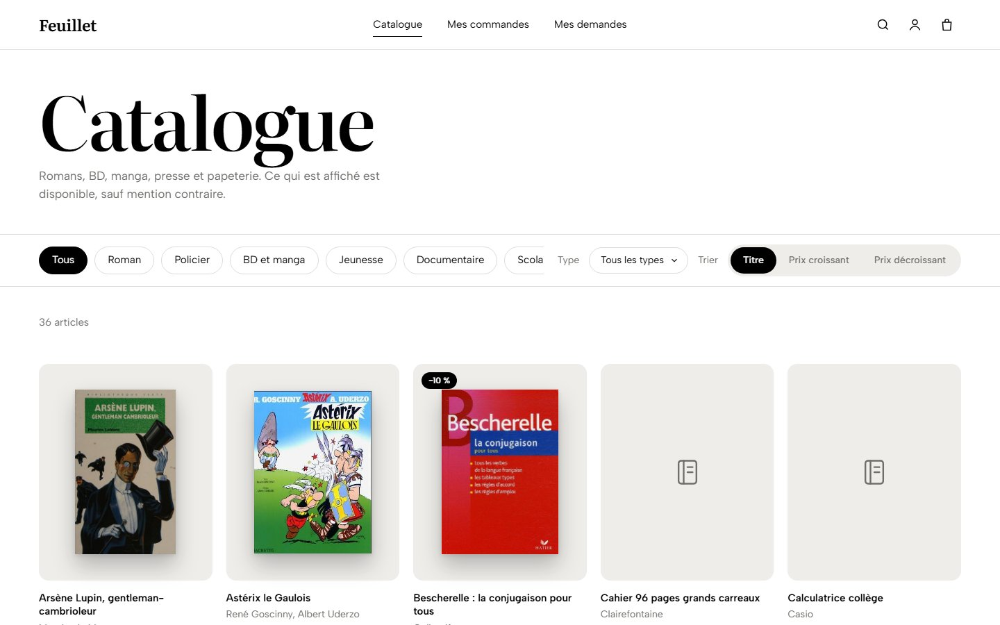</td>
    <td>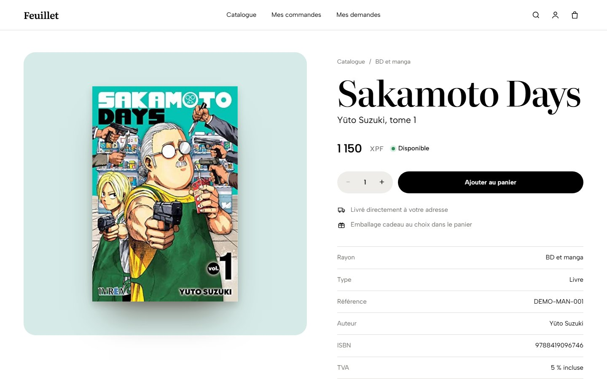</td>
  </tr>
  <tr>
    <td align="center">Catalogue avec filtres et tri</td>
    <td align="center">Fiche d'un livre</td>
  </tr>
  <tr>
    <td>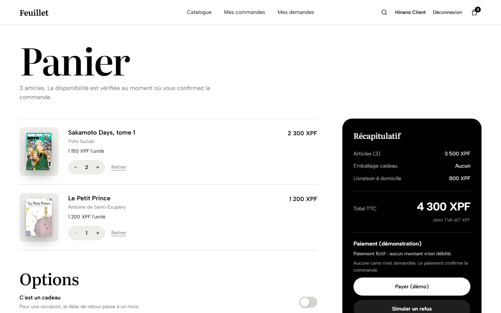</td>
    <td>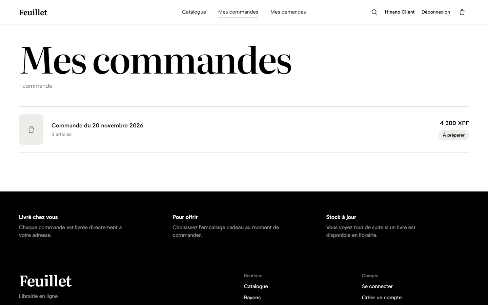</td>
  </tr>
  <tr>
    <td align="center">Panier, options et paiement de démonstration</td>
    <td align="center">Mes commandes</td>
  </tr>
  <tr>
    <td>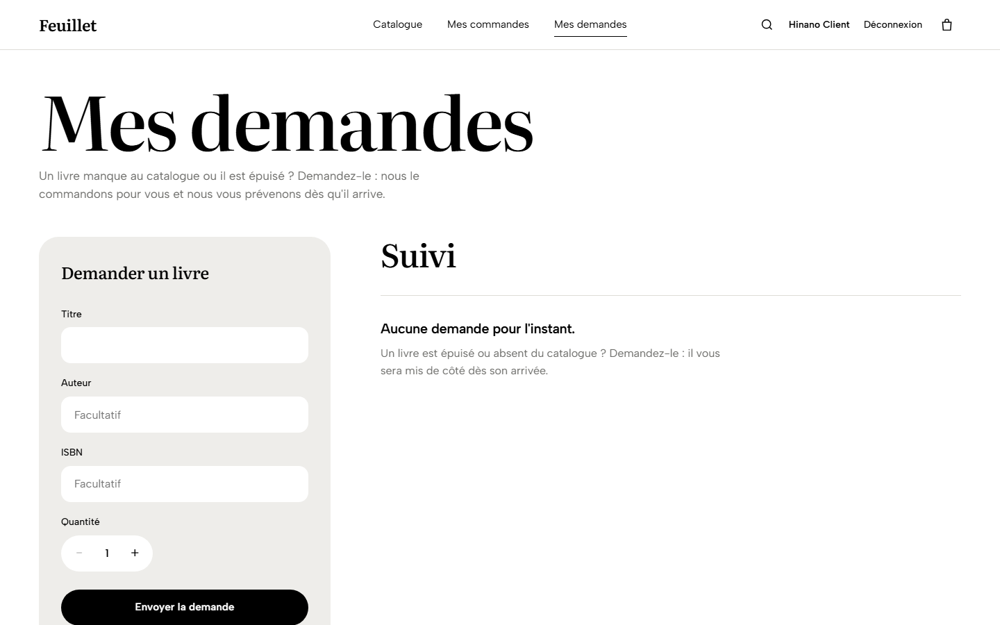</td>
    <td>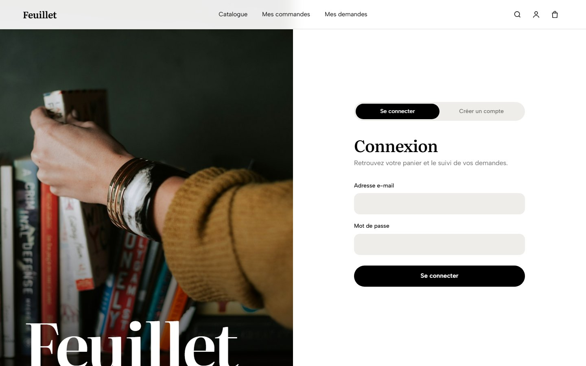</td>
  </tr>
  <tr>
    <td align="center">Demander un livre absent ou épuisé</td>
    <td align="center">Connexion et inscription</td>
  </tr>
</table>

### Espace responsable

<table>
  <tr>
    <td>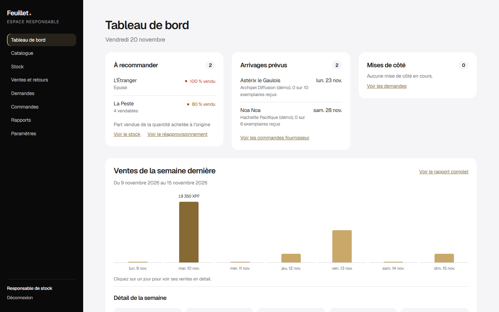</td>
    <td>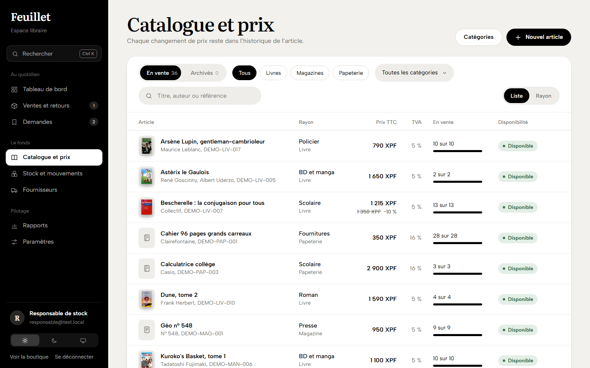</td>
  </tr>
  <tr>
    <td align="center">Tableau de bord</td>
    <td align="center">Catalogue et prix, avec le seuil d'alerte</td>
  </tr>
  <tr>
    <td>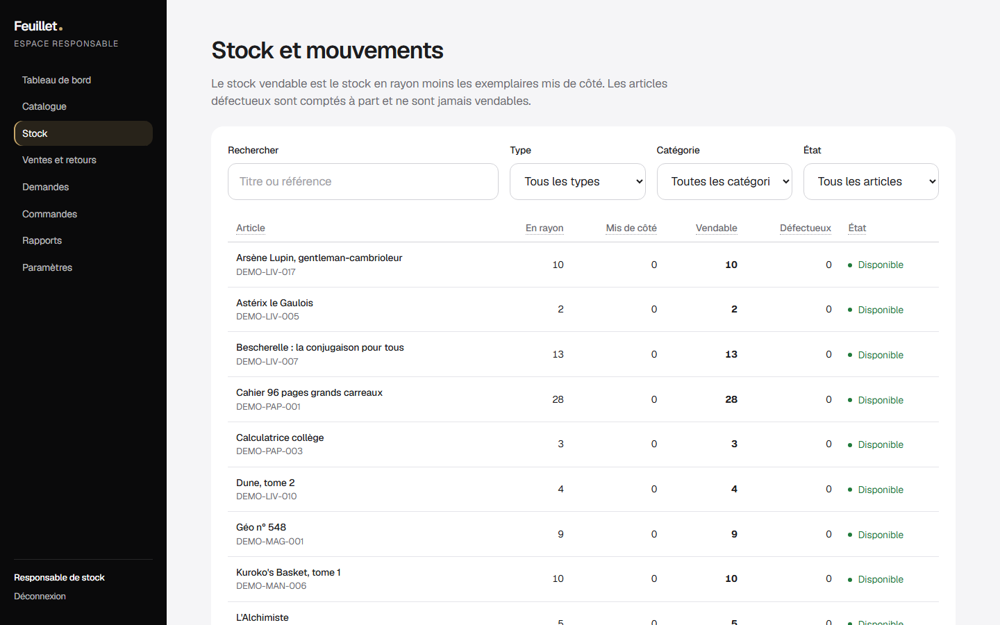</td>
    <td>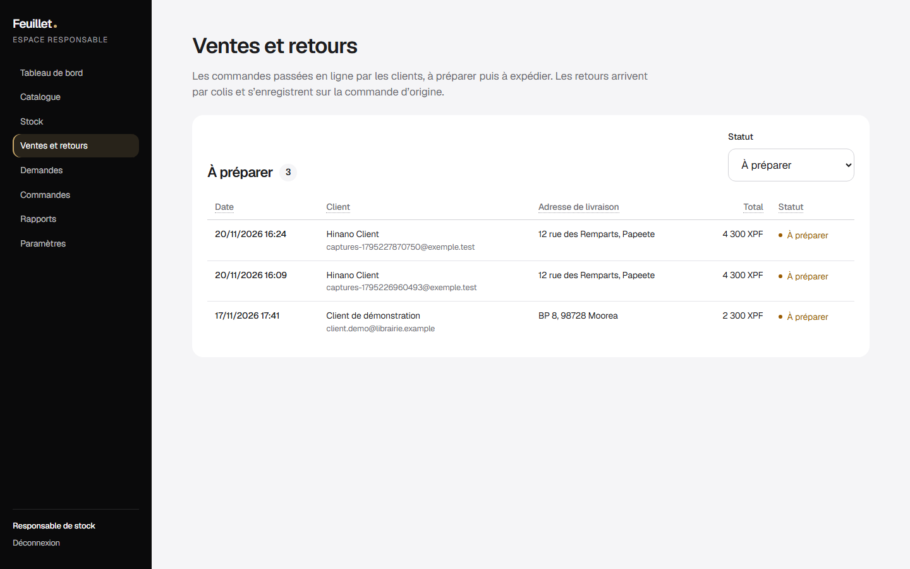</td>
  </tr>
  <tr>
    <td align="center">Stock et mouvements</td>
    <td align="center">Ventes et retours</td>
  </tr>
  <tr>
    <td>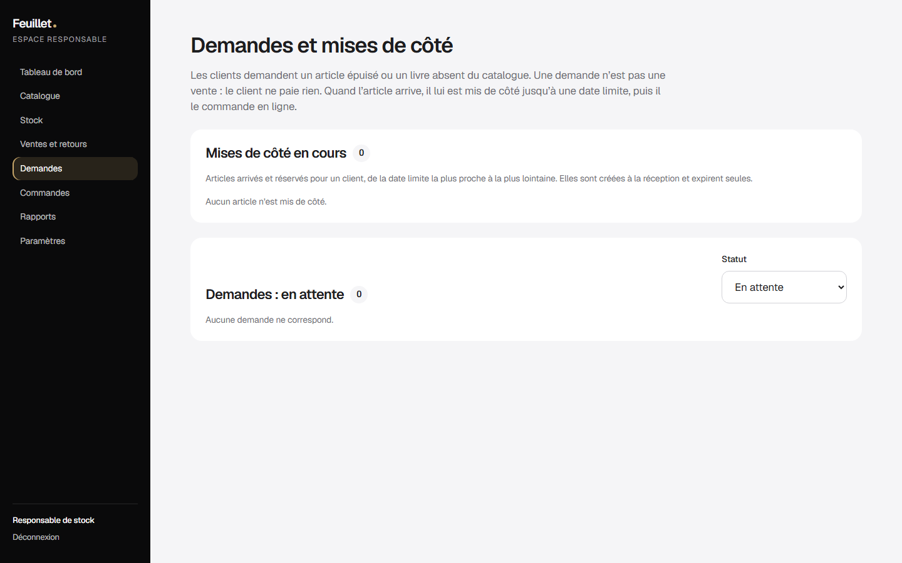</td>
    <td>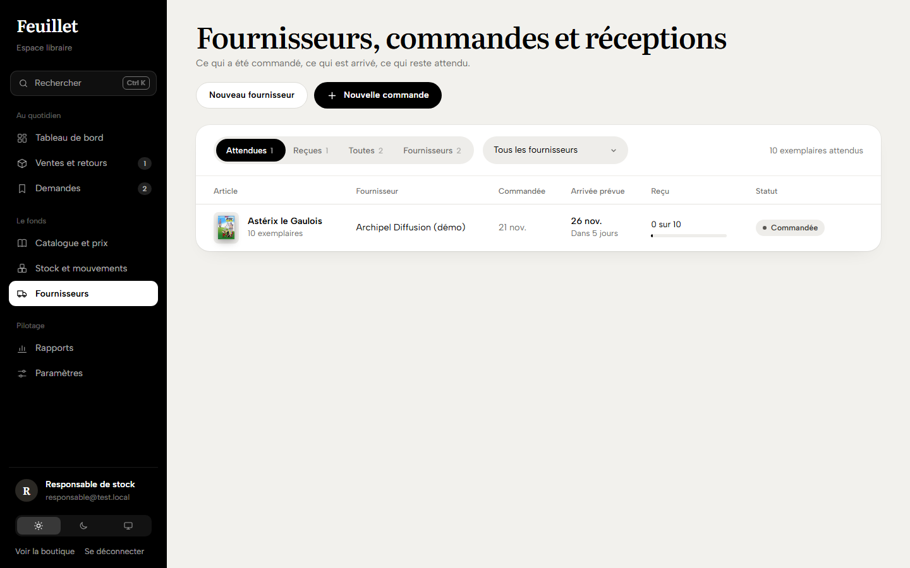</td>
  </tr>
  <tr>
    <td align="center">Demandes et mises de côté</td>
    <td align="center">Fournisseurs, commandes et réceptions</td>
  </tr>
  <tr>
    <td>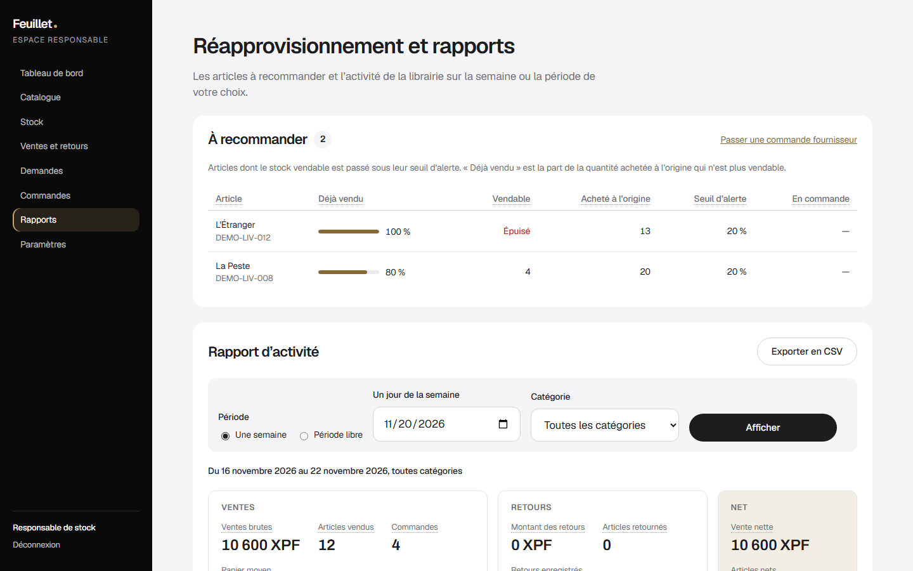</td>
    <td>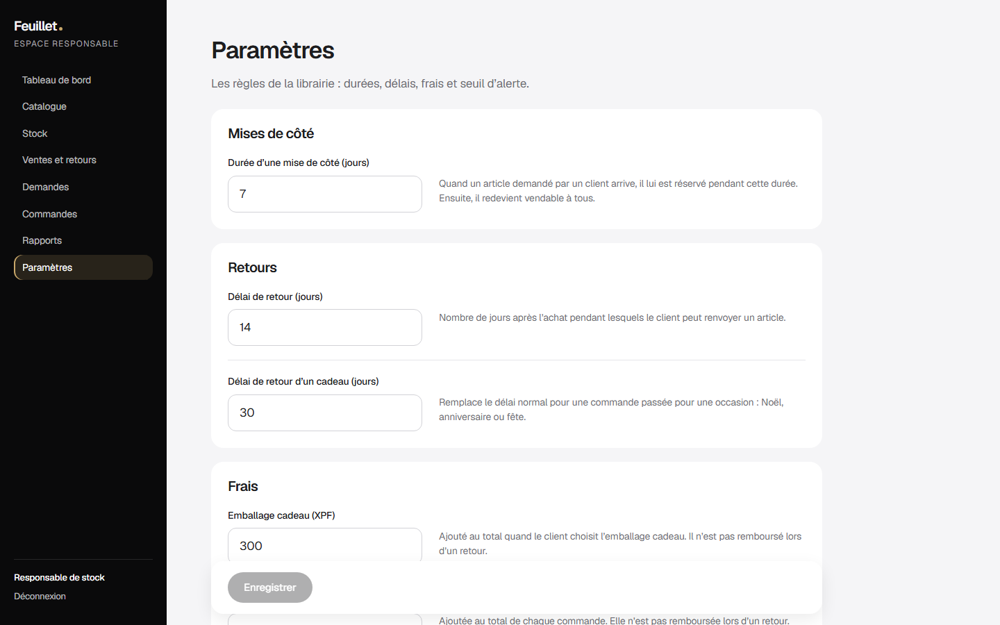</td>
  </tr>
  <tr>
    <td align="center">Réapprovisionnement et rapports</td>
    <td align="center">Paramètres</td>
  </tr>
</table>

### Sur téléphone

<p align="center">
  
  &nbsp;&nbsp;
  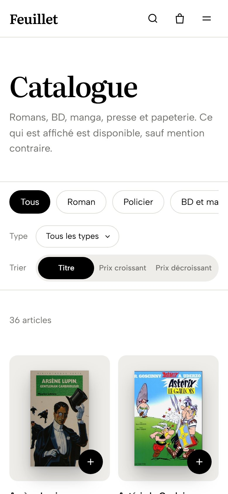
</p>

## Stack
- Front : React 19, Vite, React Router, TypeScript
- Back : Node.js 22, Express 5, TypeScript, API REST décrite dans [`docs/api.md`](docs/api.md)
- Base de données : MongoDB 7 en replica set (les ventes et les réceptions utilisent des transactions)
- Tests : Vitest et Testing Library, supertest pour l'API, Playwright pour les parcours de bout en bout
- CI : GitHub Actions ; Docker et Docker Compose pour la démo

## Tests

`npm test` dans `backend/` et dans `frontend/` lance les tests unitaires, d'API et de persistance ; `npm run lint` (front) et `npm run typecheck` (back) vérifient le code.

### Tests de bout en bout

Les tests du dossier `e2e/` font de vrais parcours dans Chromium sur l'application lancée comme en production : une base MongoDB temporaire en replica set (mongodb-memory-server), le seed, puis l'API qui sert le front compilé sur http://localhost:4173. La base est neuve à chaque lancement et `backend/.env` n'est pas lu : la base partagée n'est jamais touchée.

```sh
npm run installer && npm run build       # depuis la racine, à refaire après chaque modification du code
cd e2e
npm ci
npx playwright install chromium          # une fois
npx playwright test                      # ou --ui pour suivre les tests pas à pas
```

- Parcours client : inscription, catalogue, fiche, panier, paiement refusé puis accepté, la commande apparaît dans Mes commandes.
- Parcours responsable : il expédie une commande, la sortie de stock apparaît dans le journal et le stock baisse.
- Article épuisé au moment de payer : rien n'est enregistré et la ligne est signalée dans le panier.

Le port se change avec `E2E_PORT`. Le workflow `E2E` les lance sur chaque PR qui touche `backend/`, `frontend/` ou `e2e/` ; s'ils échouent, les captures et les traces sont dans l'artefact `playwright-captures-et-traces` (`npx playwright show-trace trace.zip`).

## Déployer

En production, l'API sert aussi le front compilé : une seule application, une seule origine, pas de CORS.

1. Variables d'environnement (voir `backend/.env.example`) : `NODE_ENV=production`, `MONGODB_URI` (MongoDB en replica set, pour les transactions), `JWT_SECRET` (32 caractères au moins), `PORT` (souvent fourni par l'hébergeur). `DOSSIER_FRONT` est facultatif (par défaut `frontend/dist`). Derrière le proxy d'un hébergeur, `TRUST_PROXY=1`, sinon les limites de requêtes comptent tous les clients comme une seule IP ; `CORS_ORIGINES` reste vide tant que le front est servi par l'API. Le seed demande aussi `RESPONSABLE_EMAIL` et `RESPONSABLE_MOT_DE_PASSE`.
2. Construire, depuis la racine du dépôt :

   ```sh
   npm run installer   # npm ci dans backend/ et frontend/
   npm run build       # front (frontend/dist) puis back (backend/dist)
   ```

3. Démarrer : `npm start` (lance `node backend/dist/index.js`).
4. Données de départ, une seule fois et à la main : `npm run seed` (compte responsable, paramètres, catégories, produits de démonstration).

Au démarrage, toutes les variables sont vérifiées et chaque problème est signalé ; les index MongoDB sont créés. Chaque requête écrit une ligne dans le journal (méthode, chemin sans paramètres, statut, durée, identifiant), jamais le corps ni les en-têtes. Les en-têtes de sécurité (CSP, HSTS en production) et les limites de requêtes sont détaillés dans [`docs/api.md`](docs/api.md). Une erreur 500 renvoie seulement un identifiant (`Référence : …`, aussi dans l'en-tête `X-Request-Id`) qui permet de retrouver la trace dans le journal. Sur `SIGTERM`, le serveur n'accepte plus de requêtes, termine celles en cours (10 s au plus) puis ferme la connexion MongoDB.

## Limites connues

Choix faits pour un projet de classe, détaillés dans [`docs/rapport.md`](docs/rapport.md) :

- Pas d'hébergement : la démo tourne en local avec Docker.
- Le paiement est simulé, aucune donnée de carte n'est reçue.
- Le token JWT (8 h) est gardé dans `localStorage` plutôt que dans un cookie `httpOnly`, limité par une CSP stricte.
- Les limites de requêtes comptent en mémoire : elles valent pour une seule instance du serveur.
- Les listes (ventes, demandes, commandes fournisseur, mouvements) renvoient les 500 éléments les plus récents, sans pagination.
- Les écritures d'un produit relisent puis remplacent le document entier : à deux modifications simultanées, la dernière gagne.
- Un échange de retour fait deux transactions ; si la seconde échoue, la commande d'échange reste et le retour est à refaire.
- Les meilleures ventes sont les mêmes pour tous les clients, faute de types de clients.
- Pas d'e-mail : les clients sont prévenus dans l'application.

Les comptes rendus de développement (`docs/backlog.md`) et les échanges avec l'enseignant (`docs/questions-prof.md`) sont conservés comme traces du projet.

## Documentation
- [`docs/rapport.md`](docs/rapport.md) : choix techniques, spécification, décisions de cadrage, traçabilité : **fait foi en cas de désaccord**
- [`docs/ecrans.md`](docs/ecrans.md) : description des écrans client et responsable
- [`docs/architecture.md`](docs/architecture.md) : diagrammes UML et modèle de données de référence
- [`docs/api.md`](docs/api.md) : contrat de l'API REST (format d'erreur, authentification)
- [`docs/questions-prof.md`](docs/questions-prof.md) : questions pour l'enseignant et ses réponses
- [`docs/backlog.md`](docs/backlog.md) : journal d'avancement
- [`frontend/README.md`](frontend/README.md) : fiche du frontend (organisation, règles)

## Contribuer

### Conventions Git
- Commits atomiques : une seule intention, fonctionnalité opérationnelle
- Messages explicites : `feat(produit): ...`, `fix(stock): ...`, `docs: ...` (voir conventional commits)
- Une branche par tâche (`feature/...`, `fix/...`, `docs/...`), fusion via pull request relue par un autre membre
- `main` toujours exécutable : les tests passent à chaque fusion
- Une issue GitHub par tâche, assignée et avec un label : [issues](https://github.com/hunixcode/feuillet/issues)

### Sécurité des dépendances
La CI lance `npm audit --omit=dev --audit-level=high` dans `backend/` et `frontend/` : elle échoue si une dépendance de production a une vulnérabilité haute ou critique, même sur une PR qui n'y touche pas. Dependabot ouvre chaque lundi des PR de mise à jour (labels `devops` et `backend` ou `frontend`).

Quand la CI signale une vulnérabilité :
1. Dans le dossier concerné, `npm audit` montre le paquet, la gravité et la version corrigée.
2. `npm audit fix` (jamais `--force`, qui peut changer de version majeure), puis vérifier typecheck ou lint, tests et build.
3. Commit séparé `fix(backend): ...` ou `fix(frontend): ...` qui cite les paquets et les versions.
4. Sans version corrigée pour une dépendance indirecte : forcer une version sûre avec `overrides` dans `package.json`. Si la faille ne concerne pas notre usage, ouvrir une issue `devops` qui l'explique et décider en équipe ; la CI reste bloquante tant que ce n'est pas réglé.

Une PR Dependabot se relit comme les autres : la CI doit passer, et une mise à jour majeure se teste à la main avant la fusion.

## Licence

[ISC](LICENSE)
